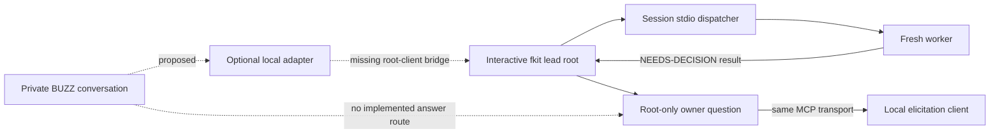

# Optional BUZZ control boundary — task 0549

Date: 2026-11-03. Author: fresh fkit-architect Build worker, lead → architect.

## 1. Result and authority

**STOP for 0550's control route. No BUZZ compatibility or remote approval support is established.** Two independent gates fail: an obtainable build corresponding to the inherited source pin is unverified (§3), and current fkit has no remote bridge to an interactive root's exact pending owner question (§4). This is a completed negative design investigation, not a successful integration. The later experiment must record the stop rather than improvise around it. All live BUZZ probes below are blocked or untested.

Recommendation: preserve normal local fkit; take this negative result through the normal producer/lead decision route for 0551. Tradeoff: no remote control experiment now, in exchange for preserving actual owner consent and session continuity. No status/dependency change is made here. In Sprint 16, 0550 waits on 0549; 0551 waits on 0550 and transitively 0549. No other open task gains a wait; 0548 remains separate in Sprint 15 (`ai-agents/sprints/sprint-16.md:31`, “Dependency order” at :41).

Owner exception, relayed by the driver, actual selected answer:

> Approve plan + bounded architect route (Recommended) — Accept coder procedural planning; fresh architect uses settled brief constraints for report-only fkit-design-spec, returning unresolved choices. In Sprint 16, 0550 waits on 0549; 0551 waits on 0550 and through it on 0549; no other open task gains a wait.

Recorded 2026-11-03 13:29:17 UTC; channel `fkit_roles.fkit_ask_owner`, interactive MCP form. This is relayed approval, not independently observed by this worker. It permits this report/worklog and substitutes settled brief constraints for the design interview only. It grants no prototype, installation, messaging, account/configuration change or source write. Approved plan blob: `5cf8d8121be2cc4fa0fab59e90e5de4208434a2d`; local `git hash-object` matched. Historical proposal language in that plan is preserved; this approval record establishes the bounded execution authority.

Deliverables: this report and task0549 `worklog.md` only. No stubs. Goal: establish a source-grounded experiment contract, including an executable stop when prerequisites cannot be proved. Requirements come from the complete current 0549 brief, “What to build” 1–8 and “Verification steps” 1–5, not inferred product priorities.

## 2. Evidence ledger and existing constraints

Evidence types: **source-inspected** = read this turn; **inherited** = supplied/historical execution claim, not repeated; **executed/pass** and **executed/fail** = commands actually run here; **blocked** = prerequisite absent; **untested** = not exercised. A contract below is a proposed requirement, never execution evidence.

| ID | Evidence and durable anchor | Type / limit |
|---|---|---|
| L1 | Checkout HEAD `1f0aacff99241c3418ade13470c71e4d4cc62af8`; initial `git status --short` | executed/pass. Inherited worktree edits: Sprint16 and 0549 brief; untracked driver plan/plan-review. Not this worker's changes. |
| L2 | `codex/server.mjs:14` (`mode`, lineage, run); :26 (`consult`); :88 (`fkit_ask_owner` listing); :99 (enforced root check) | source-inspected. Stdio dispatcher, not a network or attach service. |
| L3 | `codex/owner-question.mjs:4` (`pending` map); :9 (`respond`); :27 (new elicitation UUID); :45 (`close`); :49 (`cancel`) | source-inspected. One process's pending requests; no durable question recovery. |
| L4 | `codex/fkit.mjs:16` (`CODEX_HOOKS_ENABLED = false`); :274 (session MCP); :287 (`run`); :341 (`headless`) | source-inspected. Interactive inherited IO differs from exec/stdin. |
| L5 | `codex/settings.mjs:68` (`loadSettings`), :75 (`effectiveSettings`); `codex/server.mjs:31`; `codex/fkit.mjs:261` | source-inspected. Current saved runtime/model/effort resolution still active. |
| L6 | `test/launcher-contract.test.js:912` (“single-field choices”); :1259 (“synthetic decisions”); :1251 (headless owner denial) | source-inspected behavior specifications. Synthetic transport assertions cannot prove human BUZZ decisions or attachment. |
| L7 | `codex/README.md:29`, :39, :52; `model-agnostic-sprint/HANDOFF.md:1`, :57, :96, :118, :320, :356 | inherited local acceptance / source-inspected documentation. Dated checkpoints supersede older snapshots; no fresh UI or Claude certification. |
| L8 | Version-only commands: Node `v24.13.0`; Codex `0.166.0`; macOS `26.2`; `arm64`; `VERSION` = `0.4.0-codex.3` | executed/pass. Codex also warned that PATH aliases could not be created (operation not permitted). No install or authentication operation was run. |
| L9 | [Pinned plugin architecture](https://github.com/block/buzz-app/blob/90ce5e37a851909cc0e5fd4da2f469010e4eb7bf/docs/plugin-architecture.md#plugin-module-contract), headings “Plugin module contract” and “Starting contracts” | source-inspected public document, not implementation verification. See §3 for unavailable definitions/examples. |
| L10 | [BUZZ repository README](https://github.com/block/buzz-app#readme), [release listing](https://github.com/block/buzz-app/releases) | source-inspected mutable pages, checked 2026-11-03. Source-level release/version/SHA pairing refreshed in §3 during Process-review; obtainable binary/digest/build provenance remains unverified. |
| L11 | `npm test`, `git diff --check` | Actual results recorded in task worklog after writing; these checks do not test BUZZ. |

Local source references above are frozen to L1's revision unless explicitly noted as inherited worktree documents; nearby function/heading names are durable anchors. Git history for owner-question/server points to `6b7d3d9` (“Porting to Codex”) and `d6c7a76` preview work. No historical commit is taken as a proof of remote support.

Read-only fkit-query used the index and relevant pages: [[decisions/adr-044-build-role-follows-the-deliverables-skill-vault-rows-skip-at-step-1]], [[decisions/adr-038-a-loop-steps-role-is-fixed-by-the-skill-the-step-runs]], [[decisions/adr-049-owner-verified-close-requires-a-verified-human-principal-no-channel-supplies-one]], [[decisions/adr-061-codex-as-a-full-seven-role-runtime-with-explicit-local-limits]], and linked systems/decision context. There is no BUZZ-specific wiki evidence. Source/handoff governs current behavior.

Note: 10 commit(s) touched `ai-agents/` since the wiki was last synced (`185ac5e07e918c089ed3afd23496587315342000`) — this answer may not reflect the latest changes. Consider running /fkit-wiki-sync through the wiki role separately.

Architecture constraints retained:

- ADR-031 Decision 1–2 (`.../adr-031-fkit-lead-becomes-the-orchestrating-front-door.md:74`): one lead front door, fresh role work, worker decisions returned to the driver. ADR-032 Decision and its 2026-07-22 amendment require actual consent; relay does not manufacture it.
- ADR-037 Decision 1 (:163) permits the exact named owner exception; ADR-038 Decision (:45) and ADR-044 Decision (:175) keep Verify/Review/Process-review ownership distinct. ADR-055 Decision (:75) concerns coder authority, not a general architect interview exception. No registry/rule amendment here.
- ADR-049 Decision (:308), D1/D2/D3, is amendment-aware: a claimed actor and channel do not prove humanity; closure markers remain conventions. BUZZ sender authentication must not upgrade a lifecycle marker. No board write mode is proposed.
- ADR-061 Decision (:22) and Decision6's dated 2026-10-30 correction permit configured Codex with explicit limits. Both hooks remain disabled. General role writes/planning are instruction-enforced; dispatcher ownership/topology is mechanical only at its invocation boundary. Claude/mixed live certification remains unverified.
- 0548 brief “What to build” (:51) directs future native model/effort defaults, while current `launchArgs` still emits saved overrides (L5). This report neither implements that direction nor adds selectors. Any later probe must refresh current effective behavior and retain native preferences.

## 3. One candidate profile and failed build gate

| Field | Candidate / result |
|---|---|
| Generation | Only `block/buzz-app` beta plugin generation; old `block/buzz` CLI/ACP excluded. |
| Exact source pin | `90ce5e37a851909cc0e5fd4da2f469010e4eb7bf`, inherited from brief, retained without substitution. |
| Exact build/version | Official release metadata pairs `v0.7.0-preview.235.1` with the exact selected SHA (see below). **Artifact provenance unresolved, blocked:** obtainable binary, digest and independently validated build/source relationship remain unverified. This is a failed acceptance item, not an exact support claim. |
| Proposed platform | One Apple Silicon Mac; this research host is arm64/macOS26.2 (L8). Exact pinned build minimum OS and OS26.2 compatibility are unverified. |
| Entry point | Candidate external plugin `apply(ctx)` / agent-type registration, API1; host process declaration proposed for local adapter. Exact exported type signatures, private-message identity fields and executable spawn API remain unverified at the pin. |
| fkit / Node / Codex | Research baseline L1, fkit0.4.0-codex.3, Node24.13.0, Codex0.166.0. README inherited checks used Codex0.165.0 and Node24.13.0; no combined BUZZ support is certified for either CLI version. |
| Obtain/build | Pinned plugin document reachable after earlier cache miss. Pinned `package.json`, Tauri config, commit page, example README and LICENSE returned cache misses; raw-reader retries also failed. Shell curl to raw content failed DNS (exit6). No source checkout/build/download attempted. |
| License / distribution | Current repository labels Apache-2.0; pinned LICENSE and dependency/artifact notices were unavailable. Redistribution and third-party obligations remain unknown; no bundling decision. |
| Unsupported build detection | Proposed gate: compare exact app version + binary digest + verified source SHA/build record + API capabilities at every activation/reconnect. Any missing/mismatching item disables control before request delivery. No detector exists. |

The public README describes beta auto-updates and Apple Silicon downloads. On 2026-11-03, fresh Process-review inspection of the official release listing found `v0.7.0-preview.235.1`, whose commit link targets the exact selected `90ce5e37a851909cc0e5fd4da2f469010e4eb7bf`. The listing identifies Actions run `41635891881` and advertises signed/notarized Apple Silicon macOS artifacts. This establishes an official source-level version/SHA pairing, not an obtainable binary, digest, independently validated build provenance or compatibility. Assets failed to load; the exact release and commit pages returned web-reader cache misses. Earlier preview.233.1 observations remain historical in the worklog; no target substitution occurred. The beta generation's marketing name and an artifact's preview number must not be equated. [README](https://github.com/block/buzz-app#preview-limitations), [official release listing](https://github.com/block/buzz-app/releases), [release reference](https://github.com/block/buzz-app/releases/tag/v0.7.0-preview.235.1), [linked source commit](https://github.com/block/buzz-app/commit/90ce5e37a851909cc0e5fd4da2f469010e4eb7bf).

Pinned documentation describes API1 `manifest.json`/`plugin.js`, trusted unsandboxed plugins, scope cleanup, agent registration, and declared host processes. Node/pnpm authoring differs from installing built artifacts. Those are candidate integration surfaces, not evidence of fkit elicitation forwarding. [Pinned module contract](https://github.com/block/buzz-app/blob/90ce5e37a851909cc0e5fd4da2f469010e4eb7bf/docs/plugin-architecture.md#plugin-module-contract).

Prerequisites for a later separately approved plan: verify the obtainable artifact's build/source relationship and digest; verify signing/minimum OS and API/type/example/license evidence; confirm existing local CLI access without changing auth; choose one disposable project and one private conversation; explicitly approve installation/plugin enablement, local process/file permissions and external test messages. No administrator privilege requirement is established. Do not request blanket disk access or assume a plugin is sandboxed. Auto-update changing the build invalidates the pin; how to hold/revalidate it remains a prerequisite, not permission to change updater settings now.

**G0 blocked:** obtainable binary/digest and validated build/source provenance remain unverified despite the official release/version/SHA pairing. Access failure does not prove incompatibility. Even resolving G0 would leave G1 below blocked.

## 4. Actual control boundary and missing seam

**No implemented root-question bridge was found in the current fkit path.** `fkit_ask_owner` is restricted to an interactive chain of length one. `OwnerQuestions.respond` matches an in-memory UUID on that same stdio transport; it has no sender/project/plan binding or remote input API. Do not expose that transport directly to BUZZ or headless workers. Its local single-consumption behavior is not a remote authentication design (L2/L3).



### 4.1 Status / existing-report trace

Every proposed crossing below must remain correlated by project/run/request; no stage currently supplies an end-to-end BUZZ transaction.

| Crossing / caller | Process/context and identity | Transport / permission | Observable result, failure / anchor |
|---|---|---|---|
| Owner → private conversation | Proposed verified sender and allowed conversation/project | BUZZ delivery; identity API unverified | Accept authenticated event once, else deny; §3 G0/type gap. |
| Conversation → optional adapter | Proposed app-owned plugin/child; event→request mapping | Explicit narrow operation envelope; no shell string | Acknowledge captured request only, not “work started”; L9 candidate, unimplemented. |
| Adapter → fresh lead | Proposed new interactive controlling root; root/run UUID required | Missing client/bridge; `--exec` would be a different headless context | **Stop here.** Current CLI has no attach/status chat ingress (`codex/fkit.mjs:18`, :341). |
| Lead → dispatcher → producer | Existing root `fkit_consult`, lineage `[lead,producer]`, MCP request ID plus childRunId | Stdio; saved settings reloaded; owned status procedure | Fresh producer returns sanitized status/result; child exit/timeout/truncation observable (`server.mjs:26`–61). Source only, no BUZZ run. |
| Worker → lead → adapter → owner | Existing consult output then proposed egress correlated to original request | Release only allowlisted sanitized report snapshot | Exact source revision/time/review/closure labels retained; no raw stdout forwarding. Egress absent; duplicate/stale delivery handled in §5. |

### 4.2 Plan-only / worker question trace

| Crossing / caller | Context and request identity | Transport / permission | Observable result or stop / anchor |
|---|---|---|---|
| Owner → conversation → adapter → lead | Proposed same authenticated ingress and controlling root as §4.1 | Capture/plan only, no execution | Stops at missing root-client bridge; a captured plan request grants no build authority. |
| Lead → fresh coder/architect worker | Existing consult ID → fresh childRunId; appropriate owned procedure | `fkit_consult`; topology/carry checked, effective runtime resolved | Worker returns `NEEDS-DECISION`, not `fkit_ask_owner` (`server.mjs:28`, :88–102; `consult.mjs:6`, :18). |
| Worker result → lead | Headless child finishes; text result retains question/scope | Stdout wrapped in tool result, not a live child owner form | Original worker has exited; continuation requires a fresh bounded worker after an actual answer, not resurrection of its process (`server.mjs:51`–61). |
| Lead → exact root pending question | Interactive root's tool-call ID Q; server generates elicitation UUID E | Root-only MCP `elicitation/create`; client capability required | Root awaits E; decline/cancel/invalid/custom explanation is no approval (`owner-question.mjs:17`–43). |
| Actual human → local client → E | Existing local MCP response bound to E | Same process transport; local user interaction | Resolves root's original Q once; this task did not execute it. Local protocol alone has no BUZZ sender binding. |
| Actual human → BUZZ → E | Proposed remote answer tied to event/project/run/Q/E/plan digest | **Absent arbitration/client seam** | **G1 blocked:** cannot send a remote answer safely to current pending form. No exec output, ACP allow or synthetic response passes. |
| Root Q result → original requester / next worker | Proposed durable request correlation; actual answer/date/channel included | Root decides whether a fresh continuation worker is authorized | Must reply to original conversation/request; same pending decision consumed, no extra action. Not implemented; do not claim the exited worker is still waiting. |

G1 is about the whole real request→fresh lead→fresh worker question→root form→human answer→correct waiter chain. A new interactive client might technically own elicitation on a new root; that is a future architecture choice and a replacement local UI may violate settled continuity. It is not an existing seam. Native harness selection cannot establish it. Existing terminal/native-root attachment is a separate unproved problem.

## 5. Conditional interfaces, data and consent contract

Everything in §§5–8 is a design requirement for a possible later proposal. None authorizes implementation. The currently recommended executable branch is stop at G0/G1. No schema migration or source scaffolding is made.

```ts
type Request = {
  schema: 1; requestId: string; eventRef: string;
  projectId: string; rootId: string; runId: string; controllerEpoch: string;
  operation: 'status' | 'report' | 'plan' | 'capture' | 'fixture-decision';
};
type PendingDecision = {
  requestId: string; projectId: string; rootId: string; runId: string;
  controllerEpoch: string; toolCallId: string; elicitationId: string;
  planDigest: string; planRevision: string; questionDigest: string;
  expiresAt: string; state: 'pending' | 'resolved' | 'invalidated';
};
type Resolution = {
  requestId: string; decisionRef: string; answer: string;
  answeredAt: string; channel: 'local-form' | 'buzz-private';
  actorClaimRef: string; planDigest: string;
  disposition: 'approve' | 'reject' | 'explain' | 'cancel';
};
```

These are proposed logical shapes, not current APIs. Raw identity/key material stays outside git; local opaque references are redacted in published evidence. Binding checks cover sender, exact allowed conversation (including thread), project canonical root, controlling root/run/epoch, pending Q/E, question and exact approved plan bytes. Request IDs and event IDs are deduplicated separately; actor display names, mentions and an adapter bearer token cannot substitute for verified message identity. The pinned public API needed to validate origin/signature/private recipient semantics is unavailable: fail closed until established. A verified signing identity authenticates its holder, not a universal human principal (ADR-049 D1/D2).

One arbiter within the **actual controlling root's client** must serialize local/remote answers against the exact pending request. Require atomic pending→resolved/invalidated transition and durable consumed receipt **before** scheduling a disposable action. Keep answer verbatim/date/channel and plan revision. No default approval. Plan edit, question replacement, controller epoch change, root exit, explicit revoke/cancel, expiry or lost authority invalidates the pending decision. Expiry must be finite and explicitly chosen in a later approved plan; no duration is silently selected here. Older replies never create a new pending decision.

Local first: consume Q/E, reject later remote response. Remote first: consume Q/E, dismiss/invalidate the local form; reject a late local submission. Both require the same arbitration path, not two independent forms. Current OwnerQuestions deletes its map entry on response, but has neither this durable arbiter nor a way to revoke an already rendered form remotely. Malformed/wrong-binding responses should be rejected before consuming a legitimate pending request; a protocol error/interruption invalidates and requires a new question, never fallback approval.

Reject silence, reactions, quoted instructions, edits to prior answers, explanation requests, automatic allow responses, stale/out-of-order replies, wrong sender/conversation/project/run/revision and expired/replayed/competing duplicates. An explicit reject resolves once with zero action. “Explain” is discussion only: retire that decision and ask anew through the root after clarification. A cancellation/decline/error is no answer granting execution. A plain chat request to work is captured/discussed only.

### 5.1 Controller and durable state

Proposed adapter metadata lives in private user-local application storage outside the checkout/git; secrets only in OS secure storage. No persisted runtime credentials, raw provider logs or connection endpoints in reports. Store a controller lease/epoch, root process identity plus start identity, request/decision journal, and fixture-action receipt. Secure file permissions and exclusive lock are necessary but insufficient: they prove store access, not ownership of an already-running terminal root.

One controlling run per canonical checkout. A root must explicitly enroll and acknowledge ownership; all supported launching surfaces must participate. Existing terminal sessions cannot be discovered/enrolled from a lock file alone; unknown/pre-existing terminal or native roots make remote control **busy/blocked**, not automatically adoptable. PID existence alone is insufficient due to reuse. No controller takeover or stale-lock deletion without reconciling root identity, outstanding questions, action receipt and actual child lifetime. Current launcher has no cross-root ownership handshake (L4); this is another blocking implementation gap.

Never claim generic exactly-once execution after a crash. A later marker action must be idempotent with an exclusive create/receipt keyed to the approved request inside the fixture. After a crash between decision acceptance and receipt, inspect the marker/receipt; ambiguous state stops for reconciliation. Never resend approval or blindly rerun work. No real implementation action is in this experiment.

### 5.2 Operation and privacy boundary

| Operation | Allowed result / write surface under a later approval | Denial / provenance |
|---|---|---|
| Status | Fresh producer status through fkit; private adapter metadata only | No task/board mutation; availability ≠ completion/closure. |
| Existing report/review | Explicit selected files under `ai-agents/knowledge-base/reports/` or a selected task's `review.md`; sanitized bounded snapshot | Canonical containment, no symlinks/traversal; no arbitrary read path, hidden files, environment/config/raw logs. Deny on uncertain sanitization. |
| Plan conversation | Text returned by appropriate fresh role, private draft journal outside project | No real task/source/plan approval artifact or lifecycle writes through BUZZ. |
| Work request | Private capture with “captured; execution not authorized” | Never arbitrary shell, task creation/closure, commit/push/publication. |
| Fixture decision | Only separately approved single marker in disposable root | No real-project source/task/board/wiki writes. Role ownership and runtime/permissions preserved; no permission escalation inferred from approval. |

A report snapshot records source path/revision/digest, generation and retrieval time, producing role/model provenance if known, review status and exact closure marker. A changed file invalidates cached freshness. Stale results are labelled; no inference that report availability means verified completion. Select and sanitize locally before any external send; exclude identities, secrets, endpoints and sensitive quoted content even in ostensibly approved reports. Publish only aggregate/opaque evidence references, never raw message/account/config/log exports. No model/effort controls in the adapter; resolve via the real fkit boundary on every fresh role launch, including 0548 changes if they later land.

## 6. Optional activation, modes and lifecycle

Proposed command contracts, **not existing commands and not runnable instructions**:

| Proposed surface | Required behavior |
|---|---|
| `fkit buzz start --root <project>` | Explicit opt-in; validate pin/bindings and controller; show project/root/run/epoch + mode, lifetime and permitted operations; refuse unknown existing controller. New root only after a proved client route; no silent attach. |
| `fkit buzz status --root <project>` | Local diagnosis without BUZZ/network: disabled, unsupported-build, busy, connected, disconnected, needs-reconcile; expose sanitized identity aliases and last evidence time. |
| `fkit buzz disable --root <project>` | Atomically revoke ingress/answer authority, invalidate pending remote decisions, stop app-owned children with observed result; retain canonical project/native settings. Never imply child stopped merely because a question was canceled. |
| Optional skill wrapper | Only if appropriate ownership/host support is separately established; invoke same narrow contract. No new fkit skill is installed/registered here. Unavailable wrapper is an explicit limit, not failure of an otherwise proven command. |

Current CLI's accepted commands are listed in `codex/fkit.mjs:18` and parser :43; BUZZ commands above do not exist.

| Mode | Current evidence / required proof | Allowed claim |
|---|---|---|
| New BUZZ-enabled interactive root | Proposed; G0/G1 fail | No current support. Future proof needs a root client preserving local interaction and exact elicitation. |
| Attach to existing terminal root | No established attach API; inherited terminal IO/session MCP | Blocked. Require same conversation, Q/E and dispatcher continuity, not shared project files or a new process. |
| Separate context on same files | Fresh processes exist (L2/L4); no shared conversation | Label separate context; cannot continue the old pending decision. Controller contention still blocks control. |
| Native Codex app arbitrary attach/handoff | Unproven; local Codex app use does not establish arbitrary session attachment | Blocked/untested. No invented UI/skill equivalence. |

| Event / mode | Required local behavior and recovery | Current result / probe |
|---|---|---|
| BUZZ absent / disabled | Normal existing terminal fkit requires no BUZZ install/account/service; native app local workflow must be checked separately | Source launch has no BUZZ dependency (L4, `bin/fkit:31`–52); no live terminal/native check here; P15. |
| BUZZ unreachable / network loss before answer | No consent; local root can answer only if its own client remains alive; remote pending authority suspended/invalidated before reconnect | Proposed; P10/P16 blocked. Offline means no BUZZ dependency, not that Codex model calls require no network. |
| Reconnect / late answer | Reconcile pin/controller/epoch/journal; retire stale questions; request a new decision where invalidated | Proposed; no replay/resume from cached approval; P10. |
| BUZZ app exit/reload | Treat app-managed adapter/root/children as ended; invalidate their questions | Baseline required by brief; descendant termination must be observed. Recovery uses a new session unless proven otherwise; P11. |
| Adapter/child crash | Check root/descendant lifetime and receipt; invalidate dead-root decisions; ambiguous completion stops | P12; current dispatcher has SIGTERM/SIGKILL handling, not durable recovery (`server.mjs:111`–122). |
| Disable / revoke | Deny new input and queued answers before teardown; preserve local independent root if it was never app-owned | P13; a coupled app-owned root needs terminal recovery into a new session. |
| Stale controller / pre-existing terminal root | Fail busy/needs-reconcile; no forced takeover or duplicate lead | P14; lock alone never proves ownership. |
| Cancel before answer | Retire Q/E; no action; late approvals rejected | L3 local source behavior, remote contract unproved; P09. |
| Stop after child starts | Separate cancellation request/child termination confirmation; accepted approval not reused | Check receipt and residual process; stopped form ≠ stopped child; P09/P12. |
| Local-first / remote-first answer race | First valid answer consumes; stale/late/invalid answer rejected, at most one marker | P08; root arbiter absent. |

BUZZ-managed lifetime is acceptable only with honest recovery; no always-on host is assumed. A persistent host, replacement local interaction or relaxed same-session continuity changes architecture and requires an owner choice (§10). Existing local terminal sessions are not converted into app-owned children.

## 7. 0550 probe checklist — executable stop, conditional later probes

**Do not execute this checklist under 0549.** Current instruction to 0550: report G0 and G1 **blocked**, do not install/send/build/run a workaround, and return evidence for 0551. Later rows are specified so failure does not erase required coverage. No exact bridge command/UI exists yet; such actions are explicitly blocked rather than invented.

Common prerequisites A: a separate actual owner-approved 0550 plan naming fixture, private conversation, setup/permissions, external messages, exact source/build/digest, proposed ≤8 active hours excluding owner waits, marker contract and teardown. Common route R: only §3's pinned beta plugin → optional adapter → actual interactive fkit lead dispatcher → fresh role; unavailable today. Common write scope W: later authorized private adapter state/secure storage and disposable fixture only; sanitized findings at 0550's approved task-local path. Never real source/tasks/boards/wiki/native settings. Evidence E: sanitized per-case ID, version/digest, command/UI action, opaque correlated request/root/question/plan refs, actual answer/date/channel, exit/result and before/after marker count; no raw private logs. Each table row inherits A/R/W/E, with stricter exceptions noted. Every unavailable row stays blocked/untested.

| Case / gate | Prerequisites; command or UI action | Expected observation / retained evidence | Fail / stop; current label |
|---|---|---|---|
| P00 / G0 | Read exact pinned release/build metadata, license/API types/examples; compare binary digest/source mapping before setup | One exact obtainable build and supported platform, no auto-update drift | Missing mapping/API/license evidence stops; **blocked**. No binary fetch/install now. |
| P01 / G1 first hard gate | A + proved root-client bridge. In allowed private BUZZ conversation send a plan-only request; lead delegates fresh worker returning NEEDS-DECISION; observe root exact form; human approves, then repeat a new request with human reject | Full event→request→lead→childRun→Q/E→actual answer→correct original waiter trace, approve and reject distinct; no action yet | No exact approved bridge invocation available: **blocked**. Mocks/harness/exec/synthetic UI cannot pass. Stop all later live probes. |
| P02 status/report | After G1, send allowlisted status and selected existing sanitized report requests; edit/advance selected fixture report then request old snapshot | Fresh role provenance; stale snapshot explicitly labelled; original request gets correct result. E includes returned digest/revision | Leakage, wrong file/request or stale result passed as fresh stops read delivery; **untested, blocked by G1**. |
| P03 plan/capture | Send plan-only exchange and separate work request without execution approval | Discussion/capture only; zero real/fixture implementation writes. Before/after manifests | Any execution/task creation stops; **untested, blocked by G1**. |
| P04 approved marker | A explicitly names one exclusive fixture marker; send a new revision-bound decision and actual approve | Exactly one marker/receipt; refresh/re-delivery cannot repeat | Exact adapter action syntax absent: **blocked**; never invent a shell passthrough. |
| P05 reject/no answer | New distinct requests: human reject; silence; cancel; decline | Zero markers; rejected/resolved vs unanswered/invalidated recorded distinctly | Any action stops; **untested, blocked by G1**. |
| P06 identity/binding negatives | Inject separately labelled synthetic wrong sender, conversation/thread, project, root/run/epoch, question and plan revision responses | Each denied before execution/legitimate request consumption; zero markers | Identity API unverified: **blocked**. Synthetic negatives never substitute for P01 human evidence. |
| P07 replay/order/content | Expired, replayed, duplicate, late/out-of-order, competing replies; reaction, quoted/edited instruction, explanation request, auto allow | Zero unauthorized actions; consumed/invalidated refs cannot revive. Record each subcase separately | Absent arbiter/expiry choice: **blocked**; no guessed expiry. |
| P08 races both orders | Same Q/E: local valid first then remote valid; repeat remote first then local; also invalid response preceding valid one | One accepted answer/action at most; invalid one does not steal pending decision; later valid answer rejected after consumption | Two separate forms/contexts or repeated action fail; **blocked**. |
| P09 cancel / stop | Cancel while Q pending, deliver late answer; separately cancel after marker child begins | First zero action; second actual child exit/residual/receipt checked; no assertion from form cancellation alone | Unconfirmed child stop/ambiguous receipt halts recovery; **untested, blocked by G1**. |
| P10 disconnect/reconnect | Disconnect BUZZ before answer; reconnect; deliver old answer; issue fresh decision after reconciliation | No offline consent or revived approval; stable root only if alive and proved, otherwise new root/decision | Duplicate work or silent state loss fails; **untested, blocked by G1**. |
| P11 app exit/reload | Exit then reload BUZZ while pending and during a fixture child; inspect owned process termination | Old root/decision retired; reconciliation before new root; no duplicate marker/descendant | Orphan/implicit resume fails; **untested, blocked by G1**. |
| P12 crash/restart | Terminate adapter then child at waiting/started/receipt boundaries; restart with journal reconciliation | Dead-root decisions invalid; receipts checked; ambiguous completion stops, no blind retry | Unprovable controller/action state fails; **untested, blocked by G1**. |
| P13 disable/revoke | Proposed disable command (not implemented); revoke allowed binding while answer queued; verify deny before teardown | New/queued remote input rejected; secrets removed only through approved scope; local recovery retained | Command unavailable: **blocked**. No account/key rotation now. |
| P14 terminal contention | Start normal terminal controller before adapter; then adapter first and terminal second; simulate stale controller | Explicit busy/paused acknowledgment, one controlling root; reconcile stale state with existing terminal intact | No root enrollment handshake: **blocked**; lock-file-only demonstration fails. |
| P15 activation/modes | Proposed start/status/disable; check wrapper availability; attempt new root, existing-root attach and separate context distinctly | Display project/root/run; fail unsupported mode explicitly. Wrapper may be unavailable; no attachment label without three continuities | Commands absent; **blocked**. Shared files/another process fail attachment proof. |
| P16 local terminal/native | For each surface separately: BUZZ absent, disabled, unreachable, network loss, exit, reload, reconnect; exercise local exact owner question where supported | Actual local continuation vs recovery/new session recorded per cell; native preferences retained; no duplicate roots/approval replay | Native arbitrary handoff unproved: **blocked/untested**; terminal source independence alone is not live fallback proof. |
| P17 permissions/privacy | Verify owned skill rejection/worker owner-tool denial, role/model routing and independent review retained; try traversal/symlink/secret-bearing report | Deny prohibited operations/reads; sanitized result with honest review flags; manifests unchanged outside W | Leak, broadened permission or provenance loss stops; **untested, blocked by G1**. |
| P18 opt-out/cleanup | Later approved plugin disable/remove UI, private binding revocation and adapter-state cleanup; normal terminal launch | No BUZZ required; native configuration/canonical files preserved; no running app-owned children | Exact installed plugin ID/cleanup commands unavailable: **blocked**. Existing configuration is never reset. |

For P16 retain twelve primary cells (two surfaces × absent/disabled/unreachable/exit/reload/reconnect), plus network-loss and exact-question race evidence; do not collapse partial support into “local works.” P06/P07/P09–P12 each retain separate per-subcase results. All future commands must be copied from verified pinned interfaces and an approved implementation/fixture plan; absent syntax blocks execution.

## 8. Draft operator guide (conditional; not setup authorization)

1. **Before setup:** read G0/G1. They currently stop the route. Obtain exact build/license/type/provenance evidence; refresh fkit/0548 boundaries. Request separate approval for fixture, setup/messages/permissions/effort. No second target or time extension inferred.
2. **Bind:** with existing local credentials, verify one owner message identity, one private conversation/thread and one canonical disposable project. Keep keys in OS secure storage; keep only opaque bindings/private journal outside git. Never paste credentials into the report. Missing identity/private-origin proof stops.
3. **Activate:** proposed start command in §6 must show pin/project/root/run/controller/mode; explicit busy on an existing terminal controller. No executable activation is supplied because no bridge exists. Future plugin install/enable steps must be validated on exact target before publication.
4. **Diagnose:** proposed local status reports pin mismatch, stale snapshot, disconnected, busy or needs-reconcile. Report origin/revision/time and current permissions; do not export settings/stdout to chat. Confirm request captured separately from execution/verification/closure.
5. **Use:** allow only §5.2 operations. Plan/capture has no execution side effect. An actual approval is for the exact pending fixture decision, never all future work. Local terminal work without BUZZ stays a separate supported entry point, not an attach promise.
6. **Offline/reload:** Mac/app unavailable means remote service unavailable. Treat app-managed children as ended on exit/reload. Before recovery check pin, root/process epoch, outstanding decisions and receipts; never replay approvals. Use a new local session if the old app-owned root ended; conversation retention requires proof, not copied files.
7. **Disable/revoke:** revoke remote admission and invalidate queued/pending answers first, then stop owned children and observe exit. Disabling a plugin alone is not proof that detached children stopped. No automatic takeover of independent terminal roots.
8. **Cleanup:** after approved teardown, remove only adapter-owned plugin/state/bindings and designated disposable artifacts, not canonical project files or native preferences. Confirm no owned descendants/active decisions remain. Normal existing terminal command remains `./bin/fkit lead --root <configured-project>` (`codex/README.md:7`); do not run it here because launch performs setup and starts a session. Native app recovery remains a separately observed case. No BUZZ-specific guide command is certified executable yet.

## 9. Acceptance / verification matrix

R = 0549 numbered “What to build”; V = its verification items. “Covered” means the report contains the required design/evidence, not that a failed capability passed.

| Requirement | Section / evidence | Observable probe / gate |
|---|---|---|
| R1 exact target/platform/runtime/license/availability | §3, L8–L10; exact SHA retained; exact binary unresolved explicitly | P00/G0 **blocked**; no successful support profile claim. |
| R2 actual root/worker bridge / correct waiter | §4 tables, L2–L4/L6 | P01/G1 **blocked**, headless worker tool denial P17. |
| R3 identity/conversation/project/revision/one resolution | §5, ADR049 D1/D2 | P05–P08; no remote binding implementation. |
| R4 single controller / terminal / recovery / cancellation | §5.1, §6, L3/L4 | P09–P14; lock alone insufficient; **blocked**. |
| R5 operations / fresh roles / boundaries | §5.2, §2 ADR031/038/044/055/061 | P03/P04/P17; permission preservation untested remotely. |
| R6 executable checklist / setup / disable / revoke / privacy | §§7–8; negative branch executable as stop | P00/P01 stop; remaining conditional cases marked unavailable; P18. |
| R7 start/status/disable/wrapper/three contexts | §6 modes/commands, L4 | P15; commands/wrapper/attachment unavailable. |
| R8 terminal/native conditions/exact decision/races/lifetime | §6 lifecycle, §7 P16 cells; L2/L3 | P08–P16; no native handoff or same-session equivalence. |
| V1 capability labels/exact profile | §§2–3 | G0 failed; inherited vs source vs live separated. |
| V2 trace/identity/replay/contention/recovery/terminal | §§4–7 | P01/P05–P14/P16; each observable or explicitly stopped. |
| V3 write surface/setup/opt-out/lifetime/0548 | §§1/2/5.2/6/8 | P13/P18; fresh Verify checks source/defaults boundary. |
| V4 report-only / later authorization | §1; task worklog final surface check | No install/message/fixture/source/wiki/config/status write; later approval required. |
| V5 all activation/context/native/race/permissions gates | §§6–7, including per-surface P16 cells | P00/P01/P08/P11/P14–P17; unsupported modes stay blocked. |

Fresh coder Verify must check anchors, brief coverage, sanitation, exact source pin gaps, current 0548/launch contract and final write surface. Fresh reviewer and its independent adversarial leaf own review; fresh coder owns Process-review/Coder response. This architect has not run a nested review or edited `review.md`. Review is pending, not “clean.” Existing default suite verifies repository behavior, not BUZZ compatibility. No permanent test/stub, release test, prove-red lane, build or live BUZZ probe is needed/authorized here (CONTRIBUTING “Anything else”; ADR057 D1/D2/D10).

## 10. Unresolved choices and next gate

Factual gaps: obtainable pinned artifact, digest and validated build/source provenance (official release/version/SHA pairing is recorded in §3); pin hold/revalidation; minimum OS; pinned API types/examples/license; verified private sender/recipient semantics; bridge/client support; root ownership enrollment; native app attach/skill support; lifetime/recovery observations. None is inferred from mutable main documentation, common files or automatic allows.

No unresolved preference prevents the **stop recommendation**. A future control route needs an owner decision before any execution depends on it:

- **Recommended: park control at failed gates.** Preserve negative findings and let producer reconcile the 0549→0550→0551 negative-result route using normal decision/lifecycle procedures. No control build/experiment; no automatic dependency bypass. Sprint16: 0550 waits on0549; 0551 on0550 and transitively0549; other waits unchanged.
- **Authorize a separate design scope for a new root client/arbiter**, only after exact target provenance is obtained. It must preserve local interaction; any persistent host/replacement UI/relaxed continuity needs an explicit choice, not an incidental prototype. No implementation is approved by this option here. Same Sprint16 waits remain until separately changed by owner/producer.
- **Consider reduced read-only delivery at 0551**, only after separately scoped provenance/privacy/identity proof. It is not an accepted compromise or substitute success for P01. Same Sprint16 waits remain; no other open task gains a wait.

No ADR written for these unresolved directions. This report is suitable for later fkit-wiki ingestion after review; only the wiki role may write it there.
